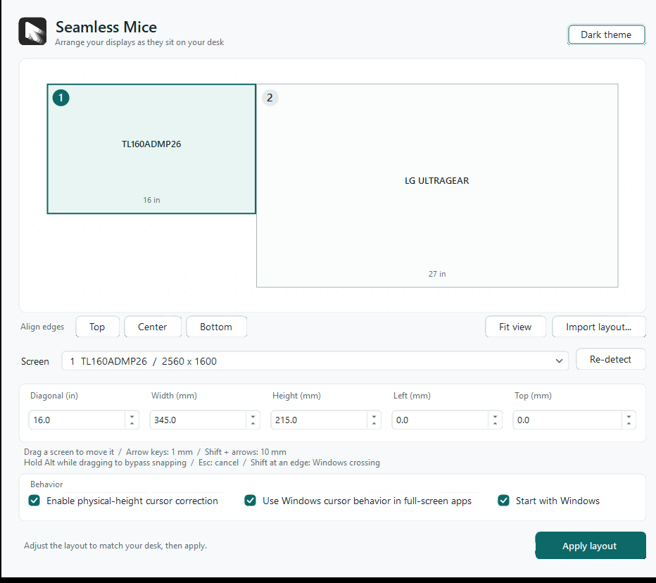
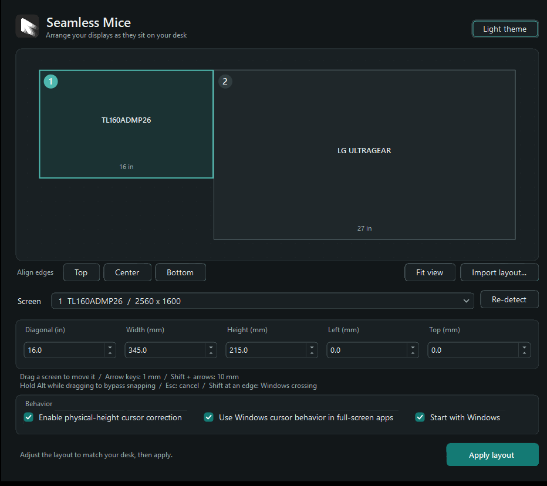

<p align="center">
  
</p>

<h1 align="center">Seamless Mice</h1>

<p align="center">
  <strong>Physically natural cursor crossings between displays of different sizes.</strong>
</p>

<p align="center">
  <a href="../../releases/latest"></a>
  
  
</p>

<p align="center">
  
  
</p>

## What it does

If your laptop is shorter than your monitor, raw pixel coordinates make the pointer jump vertically when it crosses the seam. Seamless Mice uses the physical dimensions of each panel and the layout you arrange in the editor to preserve the pointer's physical height across the crossing.

It is a small Windows utility, not a display manager. It does not resize windows, change text scaling, or replace your graphics driver.

- Physical-height crossings through **left, right, top, and bottom** edges
- Gaps are crossed directly; exposed edges stop the pointer
- Overlapping physical rectangles are rejected before applying
- Panel names and sizes are read from EDID when available
- Native background engine, separate short-lived settings editor
- No network requests, telemetry, update checks, or background polling
- Light and dark themes with WinUI-style rounded controls
- Optional per-user **Start with Windows** entry, off by default

## Install

1. Exit any running copy of Seamless Mice from the notification area.
2. Download the latest **Windows x64 MSI** from [Releases](../../releases/latest) and run it.
3. Launch **Seamless Mice** from the Start menu.
4. Match the screen rectangles to your desk, then click **Apply layout**.

The installer places the program in `C:\Program Files\Seamless Mice` and requests administrator rights. Calibration lives in `%APPDATA%\SeamlessMice`, so the editor and engine run normally without elevation. Portable builds keep `seamless-mice.ini` beside the executable.

To bring over a portable configuration, use **Import layout** in the editor. Existing 0.2.x installations are upgraded in place, and calibration is retained on uninstall.

## Using the layout editor

Drag a screen rectangle to move it. Edges and centers snap; hold **Alt** while dragging to disable snapping. Select a rectangle and use the keyboard for exact placement.

| Action | Control |
|---|---|
| Move by 1 mm | Arrow keys |
| Move by 10 mm | Shift + arrow keys |
| Drag without snapping | Hold Alt |
| Cancel a drag | Esc |
| Fit the complete layout in view | **Fit view** |
| Use Windows' normal crossing at a seam | Hold Shift |
| Pause or resume correction | Ctrl + Alt + Shift + M |

Right-click the tray icon for **Settings**, **Pause/Resume correction**, **Re-detect screens / repair hook**, and **Exit**.

The first launch follows the Windows app theme. Use the **Dark theme** / **Light theme** button in the header to override it; the choice is stored in `editor.ini` beside the calibration file.

## Build from source

Requirements:

- Windows 10 or 11, x64
- .NET Framework 4.x (included with Windows) for the editor and checks
- Visual Studio Build Tools with the **Desktop development with C++** workload and a Windows SDK for the native engine

Build and run the checks:

```bat
build-native.cmd
bin\SeamlessMice.Settings.exe --editor-checks
bin\SeamlessMice.Check.exe --displays
```

Create the portable ZIP and MSI:

```powershell
powershell.exe -NoProfile -ExecutionPolicy Bypass -File package.ps1
powershell.exe -NoProfile -ExecutionPolicy Bypass -File installer\build-msi.ps1
powershell.exe -NoProfile -ExecutionPolicy Bypass -File installer\verify.ps1
```

`build.cmd` builds the managed editor, shared core, and tests. `build-native.cmd` adds the native engine and places it at `bin\SeamlessMice.exe`.

## Verification

- Geometry and configuration: **8,639 assertions**
- Native geometry: **8,614 assertions**
- Native installed-path and settings parser: **14 checks**
- Editor drag, snap, keyboard, numeric-field, and picker checks: passed
- MSI: **100 native Windows SDK ICE checks**, zero errors or warnings
- Installer runtime regressions: **20 assertions**
- All six embedded MSI payload files match the tested binaries by SHA-256

Four script-based SDK ICE checks were unavailable in the validation environment. The 0.2.3 MSI has been installed successfully on Windows 11; uninstall and the engine lifecycle smoke test (which needs the installed engine closed) remain untested here.

## Project layout

| Path | Purpose |
|---|---|
| `native/geometry.hpp` | Allocation-free native crossing calculation |
| `native/engine.cpp` | Native Win32 background engine |
| `src/Settings.cs` | Layout editor and calibration workflow |
| `src/Theme.cs` | Light/dark palettes and rounded controls |
| `src/ScreenPicker.cs` | Themed display picker |
| `src/NumericField.cs` | Themed numeric field with spinner |
| `src/Config.cs` | Validated calibration and atomic persistence |
| `src/Displays.cs` | Monitor bounds, device identities, EDID measurements |
| `installer/` | MSI authoring and validation |
| `tests/` | Geometry, configuration, and lifecycle harnesses |
| `docs/` | README screenshots |

## Notes and limitations

The engine honors cursor clipping and, by default, uses Windows cursor behavior in full-screen applications. A normal-privilege low-level hook cannot cover elevated applications or the secure desktop. Games using raw input or aggressive cursor clipping may also bypass correction.

Hardware-specific polling rates, input latency, docking/sleep transitions, and long-running stability still need real-world testing. See [PERFORMANCE.md](PERFORMANCE.md) for the measured resource budget and remaining benchmarks.

## License

MIT. See [LICENSE](LICENSE).

The feature scope and physical-coordinate approach were informed by [LittleBigMouse](https://github.com/mgth/LittleBigMouse) and [physmouse](https://github.com/lieberlenny/physmouse). No upstream implementation is vendored. Design notes are in [DESIGN.md](DESIGN.md).
